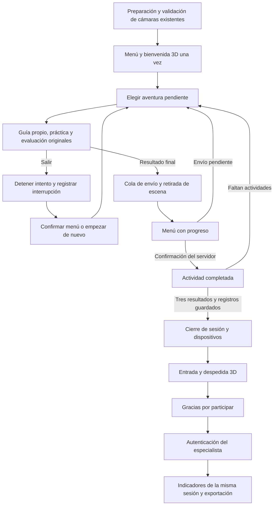
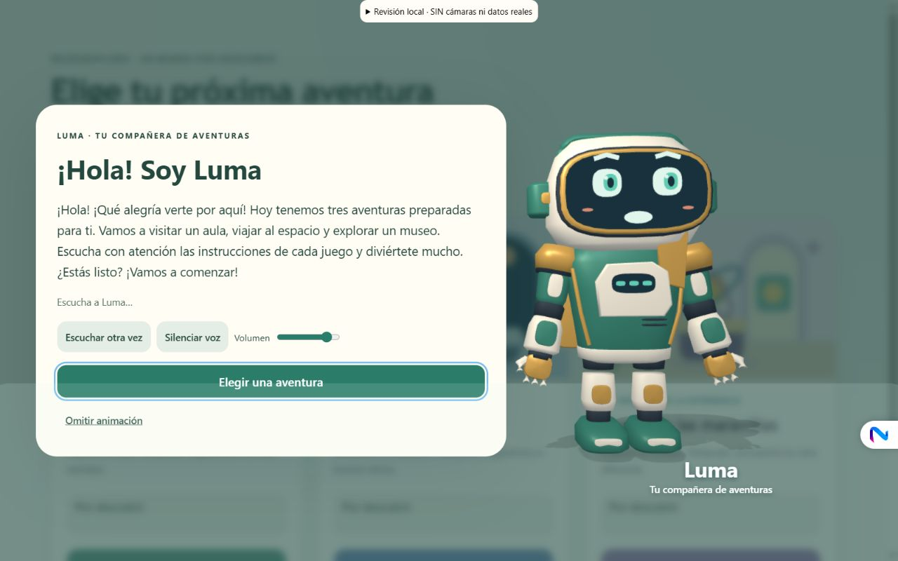
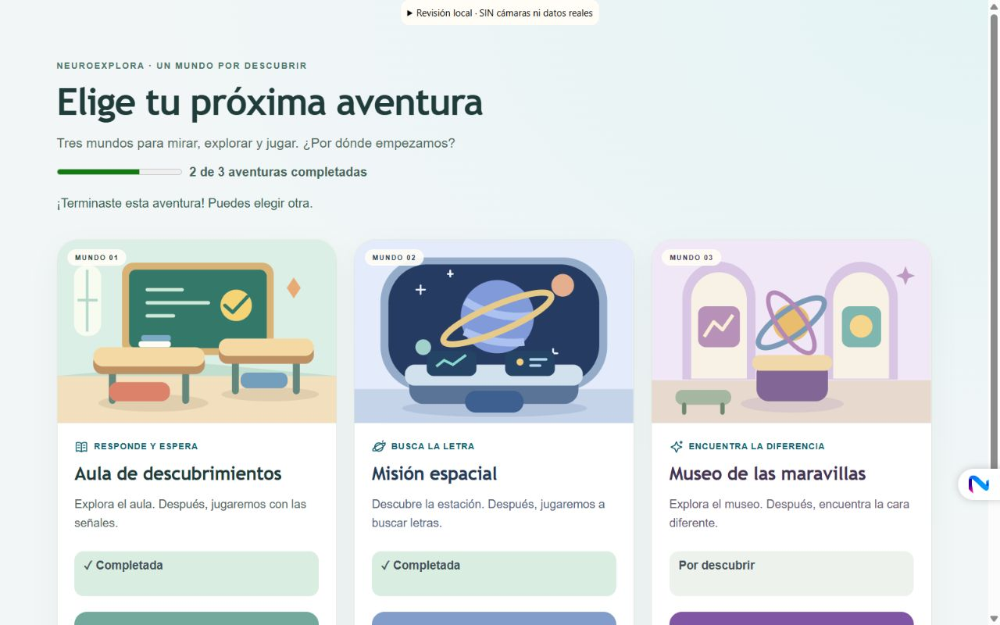
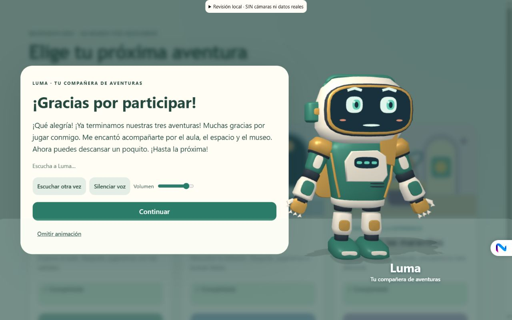
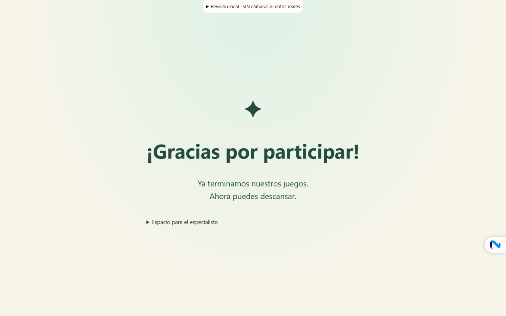
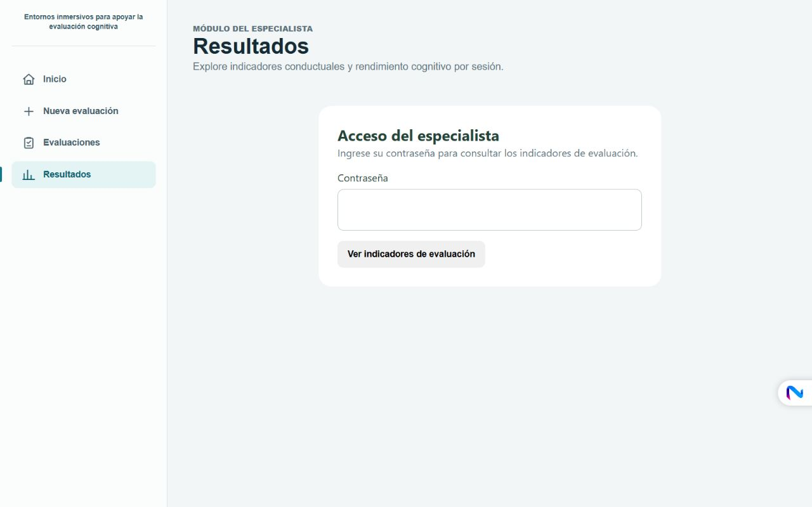

# Navegación, progreso y anfitrión de la evaluación

## Diagnóstico del flujo anterior

La preparación ya creaba una sesión UUID, solicitaba cámaras, comprobaba calidad y calibraba la cabeza mediante `AnalysisApplicationController`, `EvaluationSetupView` y `AnalysisSessionManager`. Al continuar se iniciaba `BehaviorTrackingManager` y su `DataSyncManager`. No se sustituyen esos módulos.

`main.ts` abría un selector sin progreso. Las actividades emitían `onActivityResult`, pero permanecían en la escena final con opción de repetir. El controlador principal añadía un botón manual de regreso. El menú permitía finalizar sin las tres actividades y el backend aceptaba la lista de escenarios declarada por el cliente. El envío de resultados no tenía una exclusión de solicitudes concurrentes y marcaba un escenario completo antes de confirmar el guardado.

Había regreso durante exploración y mediante M en el museo, pero no un control global durante todas las pruebas. Los resultados ya se almacenaban por sesión y se consultaban/exportaban en `SpecialistResultsView`, sin autenticación. No se encontró un mecanismo existente de autorización que pudiera reutilizarse.

## Flujo implementado

`EvaluationFlow` mantiene un UUID de sesión y un identificador nuevo por intento. Expone pendiente, en curso, completada, interrumpida y error técnico; distingue también un resultado terminado pendiente de guardado. Impide doble inicio, finalizaciones repetidas, resultados de un intento antiguo y despedidas duplicadas. `EvaluationJourney` conecta esa lógica con escenas, menú, confirmación, persistencia y anfitrión.

La fase de cámaras sigue controlada por la máquina de estados de análisis existente. La nueva máquina comienza al entrar al recorrido infantil; no sustituye la calibración. Una vuelta al menú libera la escena de actividad, sin apagar las cámaras ni reiniciar MediaPipe entre juegos. Se conserva el único motor y bucle de render de la aplicación; el anfitrión utiliza temporalmente ese mismo motor.

## Regreso y finalización de actividades

Un botón fijo «← Volver al menú» permanece en exploración, instrucciones, práctica y evaluación. Todos los puntos de regreso de las escenas se conectan al mismo control. Al solicitar salir, primero se detienen el intento, sus temporizadores, voces, sonidos y escena; después se presenta el diálogo. Una confirmación no puede ocultar ensayos que continúen registrando respuestas.

**Decisión de integridad temporal:** no se implementa una pausa que reanude un ensayo. «Empezar de nuevo» crea otro intento y vuelve al inicio de la aventura. El texto lo explica expresamente. «Volver al menú» conserva el estado interrumpido y permite elegir otra aventura. No se genera un resultado cognitivo completo artificial para una salida anticipada.

Los eventos `ACTIVITY_STARTED` y `ACTIVITY_INTERRUPTED` registran sesión, escenario, intento, fase, reloj relativo de sesión y fecha. Las muestras y resultados nuevos llevan `attemptId`. Los datos conductuales parciales conservan su procedencia y no se mezclan silenciosamente con intentos válidos.

Cuando una actividad emite su resultado final, el retorno se programa en una microtarea para que la tarea termine su propia finalización antes de destruir la escena. La cola de resultados usa una sola operación de envío concurrente y elimina duplicados por escenario/intento. El menú puede aparecer mientras se completa el envío; muestra «Guardando tu aventura…» y **todavía no marca completada** esa actividad. Al recibir confirmación, actualiza el progreso automáticamente. Las demás aventuras siguen disponibles.

El progreso de la sesión activa se conserva en memoria al navegar. Los resultados confirmados actualizan `scenariosCompleted` en MongoDB y los eventos de intentos se almacenan en la misma sesión. No se implementa restauración automática de una evaluación tras recargar/cerrar el navegador ni una nueva base local de registros clínicos. Si hay envíos pendientes no se debe cerrar la página: esta limitación de recuperación permanece explícita.

El backend comprueba los tres pares reales guardados (`classroom/go-no-go`, `space-station/cpt`, `interactive-museum/visual-discrimination`), rechaza resultados asociados a intentos interrumpidos y no confía en una lista de finalización enviada por el frontend. Las solicitudes de cierre concurrentes se comparten y un cierre ya guardado devuelve el resultado existente. La respuesta al niño solo confirma el cierre; no expone indicadores.

## Luma como anfitriona

Se reutiliza el GLB original y elaborado de Luma, con su rig de nodos, clips originales, visor, manos, accesorios y morph targets. No se descarga un modelo adicional ni se afirma skinning, captura de movimiento, IK o root motion.

`MenuHost` crea una escena transparente con cámara fija e iluminación y sombra propias. Luma entra desde una posición lateral y una profundidad mayor, se acerca mediante una curva suave, gira el cuerpo, saluda y habla. Su desplazamiento modifica realmente la perspectiva del modelo 3D. Se combinan clips del GLB, quaternions, gestos de brazos, cabeza, torso y cambios de apoyo en las articulaciones de cadera. Después se aleja, gira y se retira. No se simula una caminata con pasos.

La bienvenida se presenta una vez tras la validación de cámaras. «Escuchar a Luma» permite repetirla voluntariamente desde el menú. No se repite automáticamente entre actividades. La despedida solo se activa tras confirmar los tres resultados y el cierre de registros. El texto agradece la participación sin afirmar éxito, puntuación ni resultado clínico.

Se incluyen repetir, volumen, silencio, continuar y omitir. Escape permite continuar; el foco permanece dentro de la presentación y el menú queda inerte mientras habla. Movimiento reducido acorta y reduce desplazamientos. Hay alternativa escrita ante fallos de voz/modelo y un límite de 60 segundos para que una presentación fallida no deje el menú bloqueado. Un navegador puede bloquear el primer audio automático: «Escuchar otra vez» es la alternativa explícita.

Los dos guiones exactos solicitados están en `src/guides/host-narration.es.json`. Audios `host-es-MX-v1`, generados localmente con **Microsoft Sabina Desktop, es-MX**, velocidad 0 y pausas de 160 ms. Duraciones: bienvenida 21,02 s y despedida 17,28 s. El manifiesto conserva la enumeración real de voces, hashes y marcas del motor. Sin envío de datos a TTS externo. Boca con tres morph targets y visemas del motor; RMS para silencios/alternativa. No se afirma voz ecuatoriana ni sincronización fonética completa.

## Acceso del especialista e indicadores

Las lecturas de listado, detalle y línea temporal requieren autenticación real en el backend. Se usa una contraseña configurable, hash scrypt con salt aleatorio, comparación constante, límite de intentos y sesiones de acceso de 15 minutos. La cookie es HttpOnly, SameSite Strict y Secure en producción; no se guardan contraseña ni token en localStorage. Antes de entregar el menú al niño se revoca la autorización del especialista. El acceso final requiere autenticar nuevamente. No hay PIN fijo ni contraseña predeterminada en el frontend.

**Activación necesaria por el responsable:** desde `backend`, ejecutar `npm run auth:configure` en una terminal interactiva y escribir dos veces una contraseña propia de 12–256 caracteres. La entrada queda oculta. Se crea `backend/specialist-credentials.json` con el hash, excluido de Git. Reiniciar el backend. El comando no reemplaza un archivo existente. También se admite `SPECIALIST_PASSWORD_HASH` como configuración de despliegue. No se eligió ni se creó una contraseña del usuario automáticamente y no se leyó ni modificó `.env`.

Frontend y API deben utilizar el mismo hostname de sitio (por ejemplo, ambos `localhost` o ambos `127.0.0.1`) y un origen CORS autorizado para la cookie. En despliegue se necesita HTTPS. Es un control de un operador por instalación; no incorpora cuentas institucionales, SSO ni autorización multitenant. Los endpoints existentes de ingestión continúan separados de las lecturas protegidas; no se afirma una revisión de seguridad integral de todo el sistema.

La pantalla final tiene un apartado «Espacio para el especialista» y «Ver indicadores de evaluación». Abre exactamente la sesión actual en la vista existente. Presenta métricas cognitivas reales por actividad, indicadores conductuales, línea temporal, interrupciones y disponibilidad de cámaras. «—» significa ausente; no se sustituye por cero. Se conservan exportaciones JSON y CSV existentes: JSON incluye el detalle de sesión y sus resultados; CSV corresponde a la serie de movimiento disponible.

Para conservar trazabilidad sin cambiar fórmulas, el resumen histórico de todos los registros se mantiene y se añade `evaluationOnly`, calculado con las mismas funciones sobre muestras en `running-block`, excluyendo intentos interrumpidos. La vista del especialista usa ese ámbito y lo identifica. También se añaden recuentos de integridad y lista de interrupciones. La ausencia de eventos/identificadores en registros históricos limita la clasificación de intentos antiguos. Los indicadores derivados no constituyen un diagnóstico de TDAH.

En ese ámbito nuevo, las duraciones de orientación y el retorno solo utilizan episodios con inicio y final dentro del mismo intento, bloque y condición de evaluación. Se conservan sus valores originales; se excluyen episodios incompletos que podrían comenzar durante la bienvenida o la práctica. `excludedBoundaryEvents` informa cuántos eventos se omitieron por ese motivo. Los eventos íntegros y el resumen histórico siguen disponibles para la revisión del especialista.

Fuentes: [OWASP, gestión de sesiones](https://cheatsheetseries.owasp.org/cheatsheets/Session_Management_Cheat_Sheet.html), [Node.js crypto/scrypt](https://nodejs.org/download/release/v26.9.0/docs/api/crypto.html), [Microsoft, marcas de visemas](https://learn.microsoft.com/en-us/dotnet/api/system.speech.synthesis.visemereachedeventargs.audioposition). No se incorporan dependencias nuevas de ejecución ni bibliotecas de animación externas.

## Archivos principales

| Área | Archivos |
| --- | --- |
| Recorrido | `frontend/src/main.ts`, `src/flow/EvaluationFlow.ts`, `EvaluationJourney.ts`, `MenuHost.ts`, `flow.css`, `src/ui/ScenarioSelector.ts`. |
| Análisis y persistencia | `AnalysisApplicationController.ts`, `ActivityContextAdapter.ts`, `DataSyncManager.ts`, `BehaviorTypes.ts`; backend `AnalysisRepository.ts`, `AnalysisService.ts`, `SummaryService.ts`, `validation/schemas.ts`. |
| Acceso y resultados | `frontend/src/specialist/SpecialistAccess.ts`, `SpecialistApp.ts`, `SpecialistDataApi.ts`, `SpecialistResultsView.ts`; backend `middleware/SpecialistAuth.ts`, `config/env.ts`, `routes/api.ts`, `app.ts`, `scripts/configure-specialist.ts`, `.gitignore`. |
| Personaje y audio | `GuideCharacter.ts`, `SpeechPlaybackService.ts`, `LipSyncController.ts`, `host-narration.es.json`, generador/validador/envolventes compartidos y `public/assets/guides/host-es-MX-v1/`. |
| Validación | Pruebas de flujo, sincronización, API, cierre y resumen; `flow-preview.html`, `src/dev/flowPreview.ts`, scripts de `package.json`, evidencias en `docs/flujo-sesion/`. |

Las reglas, duraciones, secuencias de estímulos, programación de distractores y fórmulas de las tres actividades no se modificaron en esta fase.

## Validación y alcance

La vista `/flow-preview.html` solo existe como entrada de desarrollo y declara «SIN cámaras ni datos reales». Usa las escenas y el controlador de recorrido reales, pero sus botones de finalización simulan un resultado/confirmación para comprobar navegación y duplicados sin producir registros clínicos. No debe confundirse con completar todos los bloques científicos.

La revisión de cámaras físicas, la conexión de una evaluación real completa a MongoDB y la aceptación infantil requieren una sesión supervisada en el equipo objetivo. No se afirma haberlas realizado mediante esta vista.

Persisten advertencias anteriores de `MuseumBuilder` sobre techo/pedestales que invaden `AssessmentClearZone`. Esta fase no modifica esas posiciones ni declara resuelta la verificación de obstrucciones del museo; deben revisarse junto con los dispositivos y la ejecución completa del protocolo.

Resultados de verificación:

- Frontend: `npm test`, **75 pruebas aprobadas en 16 archivos**. Incluye progreso de tres actividades, finalización condicionada a confirmación, interrupciones, intento nuevo al reiniciar, exclusión de callbacks antiguos, duplicados y reintento de envío.
- Backend: `npm test`, **22 pruebas aprobadas**. Incluye autenticación, bloqueo/revocación, límite de intentos, acceso sin configurar, respuesta infantil sin indicadores, rechazo de cierre incompleto/interrumpido, cierre concurrente único, separación del ámbito de evaluación y exclusión de episodios que cruzan fases.
- `npm run build` correcto en frontend y backend, sin errores TypeScript. Vite conserva una advertencia de tamaño: chunk principal aproximado 6,44 MB, 1,41 MB gzip. No se afirma una mejora de FPS ni se resolvió el tamaño general del bundle en esta fase.
- Comprobación visual en Chrome: 1280 × 800 y 640 × 900. Se corrigió la superposición de los pies del modelo sobre el texto en pantalla estrecha. Repetir, silenciar y omitir devolvieron correctamente el control al menú.
- La evidencia final de revisión muestra tres actividades confirmadas, una sola solicitud de cierre, cola vacía, **0 mallas y 0 escenas**. Las confirmaciones de final de esa evidencia son sintéticas y están identificadas como tales.
- Se comprobó que la compilación de producción no contiene la página de revisión, sus botones de simulación ni la contraseña utilizada exclusivamente en las pruebas del backend.

| Caso solicitado | Verificación realizada |
| --- | --- |
| 1. Cámaras → menú | Conexión al callback existente e inicio único; regresión de módulos de cámaras aprobada. Validación física pendiente. Si falla el bloqueo del acceso por falta de servidor, se puede reintentar abrir el menú sin repetir cámaras. |
| 2. Entrada, voz y retirada | Inspección visual del GLB en Chrome y estado de reproducción; acercamiento, gestos y retirada. |
| 3–4. Salida del aula sin completarla | Botón probado en exploración; menú mostró interrumpida y 0/3. |
| 5–7. Regreso al finalizar y progreso | Recorrido de las tres escenas con señal final/confirmación sintéticas; comprobaciones automatizadas de cola y confirmación. No se ejecutaron los tres protocolos completos con participantes. |
| 8–9. Despedida condicionada y única | Pruebas de estado, cierre del servidor y recorrido visual; una sola solicitud de cierre en el JSON final. |
| 10. Indicadores del especialista | API real en servidor de pruebas con datos simulados: lecturas protegidas y revocación. Formulario de acceso inspeccionado en la aplicación. Configurar contraseña propia antes del uso real. |
| 11. Conservación de métricas al navegar | Pruebas de contexto, identidad de intento, cola con fallo/reintento y progreso entre escenas. |
| 12. Cámaras y MediaPipe | Regresión automatizada existente aprobada; sin cambios en extracción ni adquisición. No hubo prueba física con dispositivos en esta entrega. |
| 13. Voz LATAM | Validación de doce clips de actividades y dos de anfitrión, hashes y manifiestos es-MX con voz instalada verificada. |
| 14. Recursos | Retirada del anfitrión, omisión, salidas y escena final verificadas visualmente; 0 escenas al terminar. Pruebas existentes de GLB/audio y carga tardía aprobadas. |
| 15. Compilación/regresiones | 75 pruebas frontend y 22 backend; ambas compilaciones correctas. |

Se probó además la salida durante práctica real del CPT y al pasar a su tramo de evaluación. La confirmación informa del reinicio; la actividad no continúa debajo del diálogo. Estas comprobaciones de estados no sustituyen la ejecución supervisada de todos los bloques.

Evidencia visual del proyecto en la vista local:

Los JSON `revision-interrupcion`, `revision-pendiente`, `revision-practica`, `revision-evaluacion` y `revision-final` conservan los estados observados. Se mantienen separados de los datos de evaluación y no se envían al backend.
